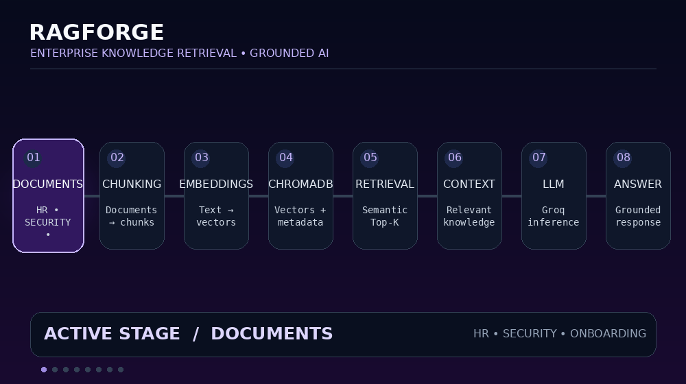
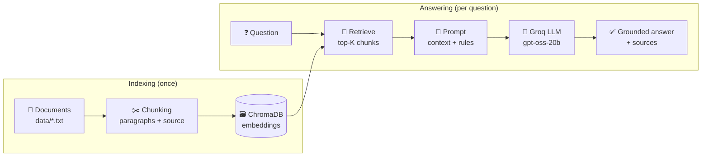

# ⚡ RAGForge

<p align="center">
  
</p>

<p align="center">
  <strong>Enterprise Knowledge Retrieval • Grounded AI</strong><br>
  A Retrieval-Augmented Generation (RAG) system that answers employee questions from company documents, and says "I don't know" when the documents don't have the answer.
</p>

<p align="center">
  
  
  
  
</p>

---

## 🎯 What it does

RAGForge searches a small knowledge base of company documents (HR, security, engineering, onboarding, product) and lets an LLM answer **only from what it finds**.

The pipeline is built by hand, without LangChain or LlamaIndex, so every stage can be inspected, tested and tuned.

| You ask | RAGForge answers |
|---|---|
| *How many days of annual leave do employees get?* | Employees receive **24 days of paid annual leave** per calendar year. <br>**Sources:** company_hr_policy |
| *What is the capital of India?* | I don't know based on the provided documents. |

---

## 🧩 Architecture



| Stage | File | What happens |
|---|---|---|
| Ingest | `src/ingest.py` | Loads every `.txt` in `data/`, splits into paragraph chunks tagged with their source (120 chunks) |
| Retrieve | `src/retriever.py` | Stores chunks in a persistent ChromaDB collection and returns the top-K most similar to the question |
| Generate | `src/rag.py` | Builds a prompt with the retrieved context and strict grounding rules, then calls Groq at temperature 0.2 |

---

## 🚀 Quick start

```bash
git clone https://github.com/Prathikchandra0/Ragforge-enterprise-rag.git
cd Ragforge-enterprise-rag
python -m venv .venv
.venv\Scripts\activate            # macOS/Linux: source .venv/bin/activate
pip install -r requirements.txt
```

Add your Groq key to a `.env` file in the project root:

```text
GROQ_API_KEY=your_key_here
```

Then build the index and ask a question:

```bash
python src/retriever.py
python src/rag.py
```

---

## 📁 Project structure

```text
├── data/                  # 5 knowledge-base documents
├── src/
│   ├── ingest.py          # load + chunk
│   ├── retriever.py       # ChromaDB index + search
│   └── rag.py             # prompt + LLM answer
├── notebooks/
│   └── rag_walkthrough.ipynb   # original step-by-step notebook
├── docs/rag_architecture.pdf
├── DECISIONS.md           # design decisions and experiment notes
└── requirements.txt
```

---

## 🧠 Key design decisions

- **Grounding first.** The system prompt allows answers only from retrieved context, with a fixed refusal phrase so refusals can be detected automatically.
- **Prompt wording matters.** In testing, a softer fallback let the model answer off-topic questions from general knowledge; strict wording fixed it.
- **Low temperature (0.2)** for factual, repeatable answers.
- **Persistent vector store**, so the index is built once, not on every run.
- **Secrets stay out of Git.** The API key is read from `.env`, which is git-ignored.

The full reasoning and experiment log is in **[DECISIONS.md](DECISIONS.md)**.

---

## 👨‍💻 Author

**Prathik Chandra** · Computer Science Engineering

`AI/ML` · `RAG` · `LLMs` · `Agentic AI` · `Backend Development`
